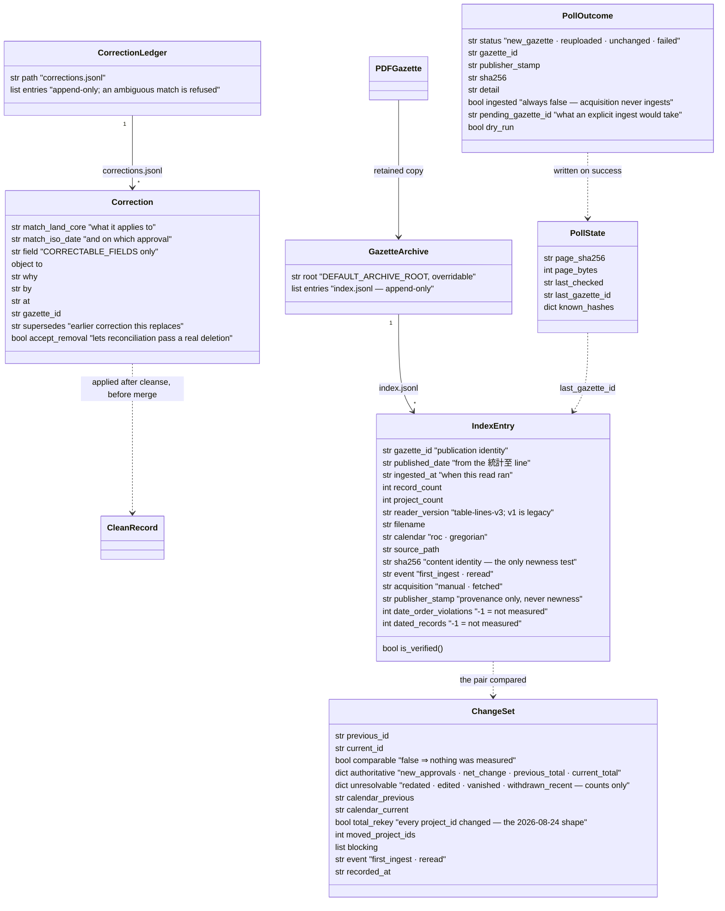

# Domain Model

```mermaid
classDiagram
    direction LR

    class RawRecord {
        int recno
        str date
        str district
        str name
        str land
        str implementer
        str planner
        str parse_error
        str gazette_id
    }

    class CleanRecord {
        int recno
        str iso_date
        tuple ymd
        str district
        str district_land
        str name
        str name_raw
        str land
        str section
        str first_parcel
        list parcels
        dict aliases
        int land_count
        int orig_count
        str named_anchor
        str area_section
        str stage
        int stage_index
        str track
        str implementer
        str planner
        list auto_fixes
        list review_flags
        str gazette_id
        dict links
        dict implementation
        str stage_事業計畫
        str stage_權利變換
        set parcel_set()
    }

    class Project {
        str project_id
        int anchor_recno
        list members
        list borderline
    }

    class DiscoveryResult {
        str project_id
        str land_core
        str twur_view_id
        str twur_url
        list city_case_ids
        dict national_milestones
        dict taipei_milestones
        dict case_milestones
        dict milestones_source
        dict implementation
        dict rewards
        dict search_rejected
        dict candidate_names
        dict case_schedules
        list view_verified_case_ids
        str status
        str error
    }

    class GraphDocument {
        int schema_version
        str generated_at
        str source
        str published_date
        dict counts
        list projects
    }

    class ProjectGraph {
        str project_id
        int anchor_recno
        str district
        str section
        str implementer
        str name
        list member_recnos
        list nodes
        list edges
        dict links
        str published_date
        dict implementation
        dict rewards
    }

    class Node {
        int recno
        str date
        str stage
        str track
        str area
        bool is_current
        str case_name
        str name_raw
        str land
        str section
        str first_parcel
        list parcels
        dict aliases
        int land_count
        int orig_count
        str named_anchor
        str area_section
        str implementer
        str planner
        list review_flags
        list auto_fixes
        str district
        str district_land
        str stage_事業計畫
        str stage_權利變換
        dict links
        dict implementation
    }

    class Edge {
        int from
        int to
        str kind
    }

    %% ---- portal payload shapes (labels are the values) ----
    class TaipeiMilestones {
        dict label ~ date   %% STAGE_FIELD_MAP from second.ashx
    }
    class TaipeiImplementation {
        dict field ~ value  %% third.ashx
    }
    class TaipeiRewards {
        dict field ~ value  %% fourth.ashx
    }
    class NationalMilestones {
        dict label ~ date   %% 推動歷程 from view/<id>
    }

    %% Field descriptions RENDER, so derivation is stated here rather than in a comment.
    class TaipeiCase {
        str case_id "案號 — the only identity"
        str case_name "free text, self-describing"
        str project_id "owning unit"
        list record_recnos "records citing it; empty ⇒ virtual"
        str node_date "ISO; \"\" if none"
        str stage "parsed ← case_name"
        str track "parsed ← case_name"
        str area "區段, parsed ← case_name"
        str declared_parcel "首宗地號, parsed ← case_name"
        int declared_count "筆數, parsed ← case_name; None if omitted"
        str schedule "審查中 · 已核准 · 施工中 · 自行撤回 · 已失效 · 已駁回"
        dict milestones "34 fields — owned HERE, not on the record"
        dict milestones_source "which case a merged milestone came from"
        str provenance "how the case was found"
        bool orphan "true ⇒ no record cites it"
    }
    note for TaipeiCase "PROPOSED — not implemented.<br/>The join key between the gazette and both portals.<br/>Today: a virtual case is one self-contained object,<br/>a real case is four dictionaries plus a duplicate."

    %% ---- sources ----
    class PDFGazette
    class TaipeiPortal
    class NationalPortal

    PDFGazette --> RawRecord : one row
    RawRecord ..> CleanRecord : cleanse/normalize
    CleanRecord "*" --> Project : members
    Project ..> GraphDocument : build_graph_document

    NationalPortal --> DiscoveryResult : twur_view_id/url + national_milestones
    TaipeiPortal --> DiscoveryResult : city_case_ids + milestones + implementation + rewards

    Project --> DiscoveryResult : discover_project_links (land_core key)
    DiscoveryResult --> NationalMilestones
    DiscoveryResult --> TaipeiMilestones
    DiscoveryResult --> TaipeiImplementation
    DiscoveryResult --> TaipeiRewards

    GraphDocument "*" --> ProjectGraph : projects
    ProjectGraph "1" --> "*" Node : nodes
    ProjectGraph "1" --> "*" Edge : edges

    %% ---- TODAY, and superseded by the case layer below ----
    Node ..> TaipeiImplementation : implementation snapshot
    Node ..> TaipeiMilestones : date-anchored ±1 day (SUPERSEDED)

    ProjectGraph --> links : project-level twur + city links

    %% ---- PROPOSED: the case layer --------------------------------------
    %% One relation only, many-to-one, stored in that direction.
    CleanRecord "*" --> "0..1" TaipeiCase : links.taipei
    %% Invariant 3: milestones live on the case; a node may reference them.
    Node ..> TaipeiCase : renders (solid when cited, dashed when orphan)
    TaipeiCase --> TaipeiMilestones : owns
```

## Notes

- **PDF** is the family skeleton and the heartbeat: one `RawRecord` per gazette row → one `CleanRecord` per node. `recno` is the only cross-PDF stable key (gazette renumbers every session).
- **Join identity** is the land core `{district}{section}{first_parcel}地號等{count}筆` (`build_land_core_key`), shared by merge and both portals.
- **Taipei** is pre-approval depth: per-`case_id` timelines (`case_milestones`), merged last-write-wins into `taipei_milestones` with provenance in `milestones_source`, plus `implementation` (`third.ashx`) and `rewards` (`fourth.ashx`).
- **National** is post-approval breadth: one `view/<id>` per project (revision rollup), `national_milestones` (推動歷程 incl. 使用核發, the only occupancy source).
- **Node anchoring** matches the node's date to a case's 核定日期/權變核定日期 exact-then-±1-day; per-record `implementation` snapshots ride onto nodes.
- **Two newer `DiscoveryResult` fields** (added after this diagram was first drawn): `case_schedules` — per-case state (已核准/已駁回/自行撤回/已失效/審查中/施工中) explaining why a project whose cases were all rejected has no national-portal page (§6.14); `view_verified_case_ids` — case_ids read off the project's *own* national view page 相關連結, portal-verified and therefore exempt from the landcore-similarity gate (§6.14 ghost creation).
- Sources: `urtpe/models.py`, `urtpe/graph.py`, `urtpe/links.py`, `urtpe/archive.py`, `urtpe/ledger.py`, `urtpe/poller.py`, `urtpe/changeset.py`, `openspec/specs/official-link-discovery/spec.md`.

## Gazette cadence — archive, ledger, poller

The model above describes one gazette. Everything that survives *between* gazettes lives
outside the repo, under `D:\project\urtpe-gazettes\` (override: `URTPE_ARCHIVE_ROOT` /
`URTPE_LEDGER`), so a bad run cannot destroy the only copy of a publication:

| File | Object | Why it exists |
| --- | --- | --- |
| `index.jsonl` | `IndexEntry` | one append-only line per ingest **or re-read**; `event` keeps them apart, so twelve entries describing three publications can no longer read as twelve publications |
| `<gazette_id>.pdf` | `GazetteArchive` | the retained copy a run rebuilds from |
| `corrections.jsonl` | `Correction` / `CorrectionLedger` | manual fixes keyed on land core + approval date, never on 編號 |
| `poll_state.json` | `PollState` | last page fingerprint and known digests |
| `poll_log.jsonl` | `PollOutcome` | append-only poll results |
| `change_sets/<gazette_id>.json` | `ChangeSet` | the reconciliation conclusion, kept after the terminal that printed it |

Three properties the classes encode, each with an incident behind it:

- **Newness is a hash, never a timestamp.** `IndexEntry.sha256` and `PollState.known_hashes`
  are the only tests. `publisher_stamp` is provenance: the city re-uploads a byte-identical
  PDF under a later stamp, so `Last-Modified` would report a new gazette every week for one
  already held. `IndexEntry.is_verified()` is deliberately stricter than "has a digest" — a
  legacy `reader_version` means the counts came from a reader that cannot be trusted to
  reproduce them.
- **Acquisition never ingests.** `PollOutcome.ingested` is always `false`; the poller
  reports `pending_gazette_id` and stops. The single-writer lock serialises writers without
  deciding which writer is correct, so wiring polling into ingestion would turn a
  concurrency guard into an ordering assumption.
- **A change set is keyed by publication, not by run.** Re-ingesting overwrites one
  publication's conclusion instead of accumulating competing records. `authoritative`
  (`new_approvals`, `net_change`, totals) is kept apart from `unresolvable` (`redated`,
  `edited`, `vanished`, `withdrawn_recent`) because this data cannot tell a deletion from an
  edit or a re-dating — filing them together would assert more than the comparison supports.
  `total_rekey` is the 2026-08-24 shape: when every `project_id` changes, the before/after
  intersection is empty and a naive diff reports success while every cache is orphaned.

## TaipeiCase (proposed — not implemented)

The gazette and the portals do not agree on what a thing is. The gazette counts
**核定案件** — one approval. The Taipei portal counts **案** — one application, which can
span several approvals. Nothing in the current model names that second thing, so it is
carried as loose keys.

**What it costs today, measured 2026-10-01 (one pass over the payload):**

- A **virtual** case (no matching record) is a self-contained 11-field object in `orphan_nodes`.
- A **real** case is scattered across four dictionaries — `case_milestones[case_id]` on the
  project, `case_schedules[case_id]` beside it, `links.taipei` on the node — and the node
  additionally carries a *flattened duplicate* of the milestones. 6 of 1,409 bindings have
  no per-case object at all.
- So drawing a virtual case is reading one object, and drawing a real case is joining four.
  That asymmetry is why the viewer handles them differently, and why 456 progress markers
  are anchored by a coin-flip: `anchoredByCase[cid] = n.recno` keeps whichever record was
  written last, and 343 cases sit on more than one record.
- Two integrity problems this shape would expose, both currently invisible because
  `orphan_nodes` is a flat list keyed by nothing: **20** virtual cases are listed more than
  once (969 entries, 949 distinct case ids), and **9** case ids appear *both* as virtual and
  as real — so the total is 1,921 or 1,912 depending on which wins.

**Three invariants, each of which a measurement supports:**

1. **`record_recnos` is the only relation between a case and the gazette.** Measured: 1,409
   bindings; 343 cases cover more than one record (up to 4); **0** records name more than one
   case. The relation is many-to-one and must be stored in that direction — never inferred
   from a shared name or a matching parcel.
2. **`case_name` is parsed, never compared.** It self-declares 段, 首宗地號, 筆數, 階段
   and track. That is what separates the 493 groups of cases sharing 段 and 首宗地號 — 365
   differ on count or stage, and 128 are identical on both. Comparing the name for equality
   — or ignoring the parts that differ — collapses those groups. 29 of 1,981 names yield no
   parcel at all and are not groupable.
3. **Milestones belong to the case, never to the record.** The node's flattened copy is a
   denormalised duplicate and is the reason a milestone can be dated two years before the
   record it is drawn against.

**Two rules fall out of it, and both fix a measured defect:**

- *Anchor resolution.* When several records carry a case, a milestone attaches to **the
  latest record approved on or before the milestone's date** — not the last one iterated.
  428 of 456 ambiguous markers resolve this way; 28 have no prior approval and should
  stay unanchored rather than be attached to something.
- *Discriminator.* When several cases share 段 and 首宗地號, separate them by declared
  count and stage. Where they are identical on both, **attach none** and report the group
  as ambiguous — a wrong attachment is worse than an admitted gap. 128 groups today.

**Open question.** 191 of 949 virtual cases carry no date at all. They are retained today
because `orphan_nodes` holds them, but a class with no position on the time axis needs a
stated home — a gutter column, or listed beneath the graph. That is a decision, not a
default.